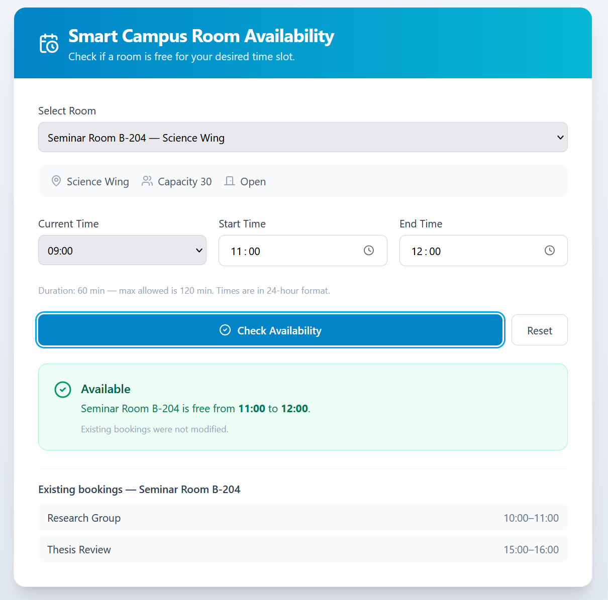
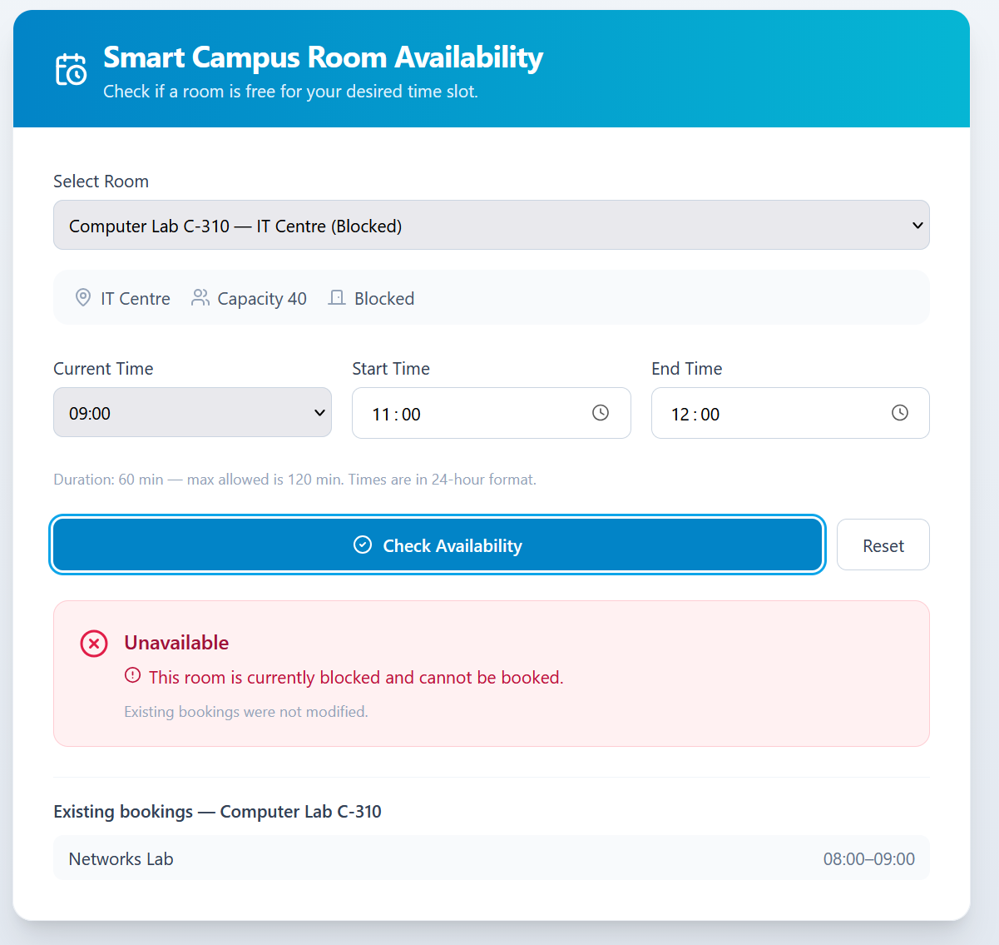
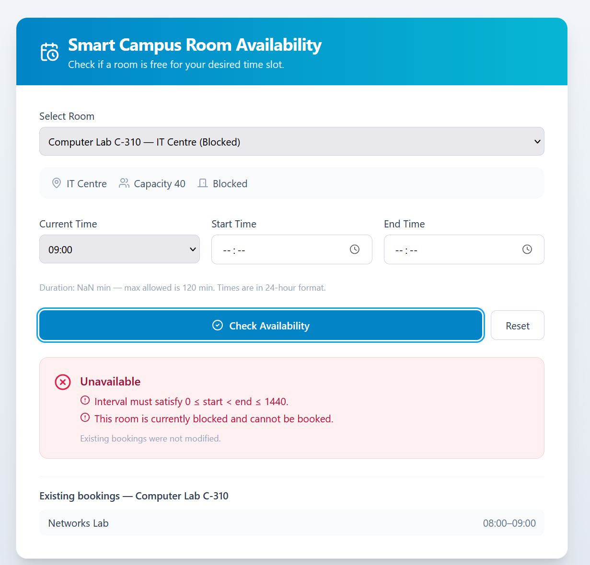
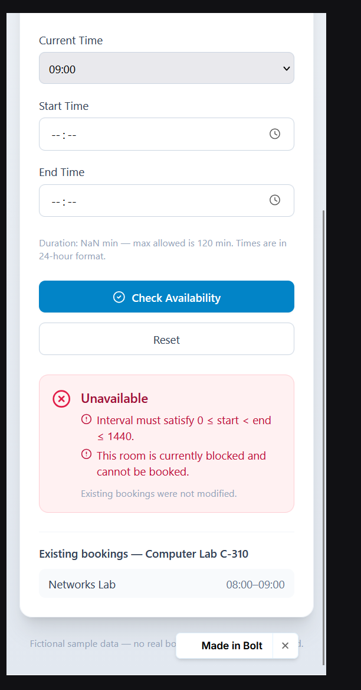
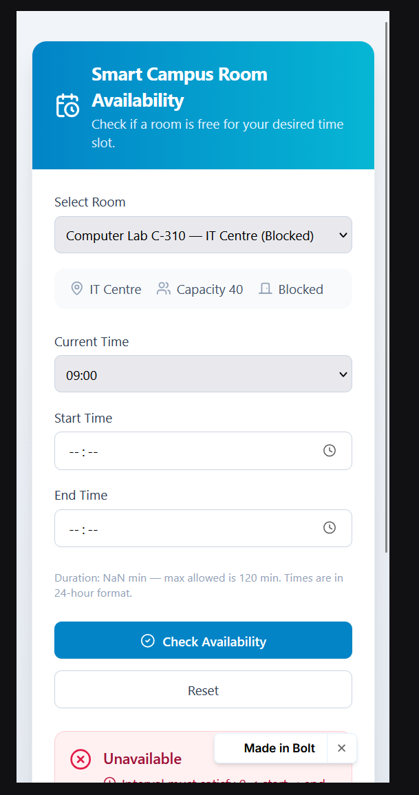
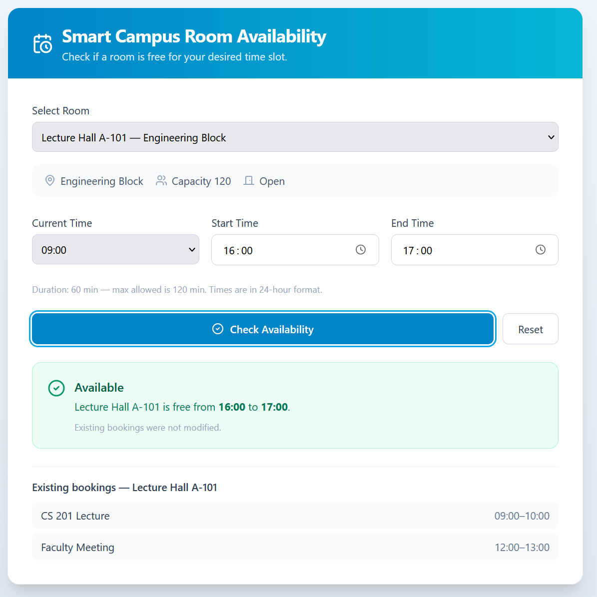
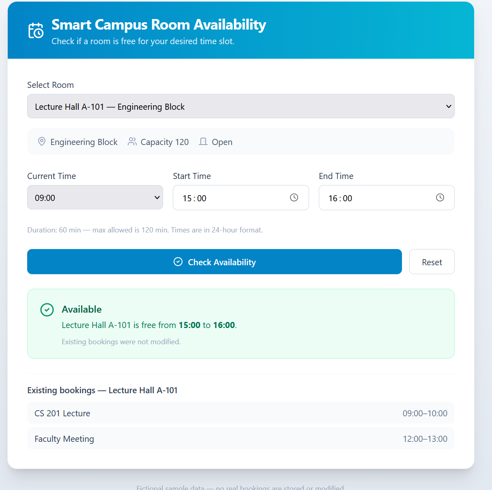

# AI-Driven Software Engineering — Practice #07
## Testing AI-Generated Code — Evidence Log

- AI tool: Bolt.new
- Project: Smart Campus Room Availability Checker (final prototype from Practice #06)

---

## Task 01 — Baseline and setup

- Saved version before editing: **"Update RoomChecker time field layout" — Oct 08, 3:49 PM** (final Practice #06 version, bookmarked in Bolt Version History)
- **Real booking function:** `checkAvailability(room, start, end, currentMinutes)` in `src/lib/rooms.ts`
  - **Inputs:** `room` (`{ blocked: boolean, bookings: { start, end, title }[] , … }`), `start`, `end`, `currentMinutes` — all numbers = minutes after midnight
  - **Returns:** `{ available: boolean, reasons: string[] }` — `available === true` means Available
  - **Used by the page (verified):** `src/components/RoomChecker.tsx` imports it (`import { …, checkAvailability, … } from '@/lib/rooms'`, lines 11–18) and calls it in `handleCheck()` with `(selectedRoom, startMin, endMin, currentMin)` → logic is already in a separate module, no extraction needed. Tests import the same function, so they test the real logic used by the UI.
- **Interface difference vs. slides:** the slides use `canBook({ start, end, now, blocked, bookings })` → `true/false`. Our function takes `blocked` and `bookings` inside `room`, `now` = `currentMinutes`, and the decision is `result.available`.
- **Test command:** `npx vitest run` _(Vitest is not in the Vite starter by default → install with `npm install -D vitest` if needed)_

**Default fixture (fresh per test):**
```ts
now = 540
room = { id: 'T', name: 'Test Room', building: 'Test', capacity: 10,
         blocked: false, bookings: [{ start: 600, end: 660, title: 'Existing' }] }
```

---

## Task 02 — Boundary, overlap and state test plan (reasons written before prompting AI)

| ID | Candidate / changed input | Expected | AC | Reason |
|---|---|---|---|---|
| T01 | 660–720 (touching after) | true | AC4 | Booking ends at 660, request starts at 660; end is excluded, so they only touch |
| T02 | 540–570 (starts now) | false | AC1 | Start must be strictly after now; 540 is not after 540 |
| T03 | 720–720 (zero duration) | false | AC1 | Needs start < end |
| T04 | 750–720 (reversed) | false | AC1 | Needs start < end |
| T05 | 1380–1441 (past day end) | false | AC1 | Needs end ≤ 1440 |
| T06 | 720–840 (120 minutes) | true | AC2 | Only *longer* than 120 is rejected; exactly 120 is allowed |
| T07 | 720–841 (121 minutes) | false | AC2 | 121 > 120 |
| T08 | 570–600 (touching before) | true | AC4 | Request ends at 600 exactly when booking starts; touching is allowed |
| T09 | 630–690 (partial overlap) | false | AC4 | 630–660 is shared with the booking |
| T10 | 570–690 (contains booking) | false | AC4 | Whole booking 600–660 is inside the request |
| T11 | 615–645 (inside booking) | false | AC4 | Request is fully inside the booking |
| T12 | 600–660 (identical interval) | false | AC4 | Same interval = full overlap |
| T13 | 660–720, blocked = true | false | AC3 | Otherwise valid (same as T01), only the block rejects it |
| T14 | 630–690, bookings = [] | true | AC4 | Same as T09 but with no bookings → nothing to overlap |
| T15 | AC5: run a check, compare `room.bookings` before/after | bookings unchanged (deep equal) | AC5 | Checking must not add/edit/remove bookings |
| T16 *(own)* | 1380–1440 (ends exactly at midnight) | true | AC1 | Upper boundary `end ≤ 1440` is inclusive; catches an off-by-one `end >= 1440` |
| T17 *(own)* | 541–600 (one minute after now, touching booking) | true | AC1/AC4 | Smallest valid start; catches a too-strict "now" check (e.g. `start <= now + 1`) |

**Why T16/T17:** T05 only checks the *outside* of the day limit and T02 only checks "start = now". Without T16/T17, an implementation that rejects valid boundary values (end = 1440, start = now + 1) would still pass the suite.

---

## Task 03 — Test-generation prompt

**Prompt:**
> Generate tests for the existing booking function using Vitest. Use AC1–AC6 and the reviewed case table below.
> Import the real function used by the page: `checkAvailability(room, start, end, currentMinutes)` from `src/lib/rooms.ts`. It returns `{ available, reasons }`. Keep its code unchanged. Use fixed time (`currentMinutes = 540`) and a fresh fixture per test: `room = { id: 'T', name: 'Test Room', building: 'Test', capacity: 10, blocked: false, bookings: [{ start: 600, end: 660, title: 'Existing' }] }`. Assert exact decisions (`available` is exactly true/false) and unchanged booking data.
> Cases: [paste the T01–T17 table from Task 02]
> Return the test file (`src/lib/rooms.test.ts`), run command, and AC mapping. Flag unclear requirements. We will run the tests ourselves.

**AI output (first suite):**
> I need to install Vitest v2 (compatible with Vite 5), create the test file, and add the test script. […] All 17 tests pass, build and typecheck are clean.
>
> **Test file:** `src/lib/rooms.test.ts` — 17 tests, all passing.
> **Run command:** `npm test` (or `npx vitest run`)
>
> **AC mapping:**
>
> | AC | How it's tested |
> |----|----------------|
> | AC1 — valid interval & start after current | T02 (start = current), T03 (zero duration), T04 (reversed), T05 (past 1440), T16 (end = 1440 OK), T17 (start = current+1 OK) |
> | AC2 — max 120 minutes | T06 (exactly 120 OK), T07 (121 min rejected) |
> | AC3 — blocked room | T13 (blocked = true → unavailable) |
> | AC4 — overlap with touching allowed | T01, T08, T09, T10, T11, T12, T14 |
> | AC5 — no booking data mutation | T15 (deep-equal before/after), plus every other test also snapshots and asserts `room.bookings` is unchanged |
> | AC6 — responsive UI with feedback | Not directly testable in a pure-function unit test; AC6 is a UI concern. The `reasons` array returned by `checkAvailability` is what the UI renders as feedback, and tests verify it's populated for rejections. |
>
> **Flagged unclear requirement:** AC6 (responsive layout, understandable validation feedback) is a UI/UX criterion that can't be meaningfully verified through a unit test of `checkAvailability` alone. It would need browser-based or component tests.
>
> **Other notes:** Vitest v2.1.9 was installed. The test script `npm test` was added to `package.json`. Each test creates a fresh room fixture and deep-clones the bookings array before calling `checkAvailability`, then asserts the bookings are untouched afterward.

**Our note:** Bolt reports "All 17 tests pass", but an AI message is not a test run — the suite is run by us in the terminal (Task 05). AC6 flag accepted: it is checked manually in Task 07.

---

## Task 04 — Review of the first suite

Check: imports the real function (not a mock)? exact `toBe(true/false)`? expected values from the AC table, not copied from output? fresh fixture per test? all T01–T17 present? duplicates? skipped tests (`.skip`, `.todo`)?

First suite: `src/lib/rooms.test.ts`, 17 tests (T01–T17), Vitest v2.1.9.

**Checklist**
- Imports the real function used by the page (`import { checkAvailability } from './rooms'`), no mocks — ✓
- Exact decisions: every test uses `expect(res.available).toBe(true/false)` — ✓
- Expected values match our Task 02 table (derived from AC, not copied from output) — ✓ all 17
- Fresh fixture per test (`makeRoom()`), fixed time `CURRENT = 540` — ✓
- No `.skip` / `.todo`, no duplicated IDs — ✓
- AC5: every test compares `room.bookings` with a deep copy taken before the call — ✓

| Test / issue | Problem | Decision | Reason |
|---|---|---|---|
| T01–T17 decisions | Correct inputs and expected values, exact `toBe` assertions, real import | **Accept** | Match the AC-derived table |
| Rejection tests (T02–T05, T07, T09–T13) | Only `available === false` is asserted — **no test checks `reasons`**, although Bolt's summary claims "tests verify it's populated for rejections". A request rejected for the *wrong* reason (or with an empty reason list) would still pass | **Revise** | AC5/AC6 require a clear decision with understandable feedback; asserting the expected reason catches wrong-rule rejections. Also: an AI statement about its own tests is not evidence — we checked the code |
| T15 vs. per-test AC5 checks | T15 partly duplicates the bookings check already done in every test | **Accept** (keep) | T15 additionally asserts the exact booking values; harmless duplication |
| Missing: several bookings | Fixture has only one booking — a defect that checks only the first booking (e.g. `bookings[0]`) would survive | **Revise — add T18** | AC4 says *any* existing booking |
| Missing: empty/invalid time input | UI passes `labelToMinutes('')` = `NaN` when a time field is cleared; every comparison with `NaN` is false, so the function may return Available | **Revise — add T19** | AC1/AC6: an invalid interval must not be Available |

---

## Task 05 — Run the first suite

- Command: `npx vitest run`
- Vitest version: **v2.1.9**
- Result: executed **17** / passed **17** / failed **0** (duration 2.40 s)
- Real output (run by us in the Bolt terminal):
```
❯ npx vitest run

 RUN  v2.1.9 /home/project

 ✓ src/lib/rooms.test.ts (17)
   ✓ checkAvailability — AC1–AC6 (currentMinutes = 540) (17)
     ✓ T01: 660–720 touching after existing → available
     ✓ T02: 540–570 starts at current time → unavailable
     ✓ T03: 720–720 zero duration → unavailable
     ✓ T04: 750–720 reversed → unavailable
     ✓ T05: 1380–1441 past day end → unavailable
     ✓ T06: 720–840 exactly 120 min → available
     ✓ T07: 720–841 121 min → unavailable
     ✓ T08: 570–600 touching before → available
     ✓ T09: 630–690 partial overlap → unavailable
     ✓ T10: 570–690 contains booking → unavailable
     ✓ T11: 615–645 inside booking → unavailable
     ✓ T12: 600–660 identical to booking → unavailable
     ✓ T13: 660–720 blocked room → unavailable
     ✓ T14: 630–690 empty bookings → available
     ✓ T15: bookings unchanged after check (AC5)
     ✓ T16: 1380–1440 ends at midnight → available
     ✓ T17: 541–600 one minute after now, touching booking → available

 Test Files  1 passed (1)
      Tests  17 passed (17)
   Start at  16:30:47
   Duration  2.40s
```
All 17 pass — but a passing suite is evidence only for the cases and assertions it checks (see review: no reason assertions, no multi-booking case, no invalid-input case).

**Failures (first suite):** none.

**Improved suite failures:**
| Test | Observed | Diagnosis | Action |
|---|---|---|---|
| T19: NaN start, end 720 | `AssertionError: expected true to be false` (rooms.test.ts:279) | **Real implementation defect**, not a test problem. Input + expected checked against AC1: an interval with a non-numeric start is not `0 ≤ start < end ≤ 1440`, so it must be rejected. In JS every comparison with `NaN` is `false`, so none of the checks in `checkAvailability` fire and it returns `available: true` | **Keep the failing test**; fix the implementation with the smallest change (see Implementation fix) |

**Improvement prompt** (first suite had no failures, so our review findings were used instead of failure output):
> Review this test suite (src/lib/rooms.test.ts) against AC1–AC6 and our case table T01–T17. Identify incorrect expectations, weak assertions, duplicated cases, and missing boundaries. For each proposed change, explain the requirement and the defect it could detect. Improve the tests without changing correct expectations to match buggy behavior. Separate test repairs from implementation fixes. Do NOT change src/lib/rooms.ts.
>
> Our review found:
> 1. Rejection tests only assert available === false. Your summary says tests verify reasons are populated, but no test checks res.reasons. For every rejection test, also assert that res.reasons contains the expected message for the rule (e.g. T13 -> "blocked", T07 -> "120", T09 -> "Overlaps", T02 -> "current time"). For available tests assert res.reasons is empty.
> 2. Add T18: room with two bookings [600-660, 780-840]; request 810-870 overlaps only the SECOND booking -> false (AC4: any existing booking).
> 3. Add T19: invalid input — start = NaN, end = 720 (what the UI sends when a time field is cleared) -> false (AC1/AC6: an invalid interval must never be Available).
>
> Keep T01–T17 and their expected results. Return the updated test file and the run command. Report which tests you expect to fail and whether that is a test problem or an implementation defect. We will run the tests ourselves.

**AI output (summary):**
> 18 of 19 tests pass; only T19 fails, and it's an implementation defect, not a test problem. Changes (all test repairs, no implementation changes):
> 1. **Reason assertions on every test** — rejection tests assert `res.reasons` contains the specific message for the rule; available tests assert `res.reasons` equals `[]`.
> 2. **Centralized reason strings** in a `REASONS` constant.
> 3. **T18** — bookings `[600–660, 780–840]`, request `810–870` overlaps only the second → `false`, reason names "Second".
> 4. **T19** — NaN start (cleared time field) → expects `false` per AC1/AC6.
>
> T19 fails because `checkAvailability` doesn't guard against `NaN`: every comparison involving `NaN` returns `false`, so all checks silently pass and the function returns `available: true`. The test expectation is correct; the implementation needs a NaN guard in `src/lib/rooms.ts`.

**Review of the improved suite**
| Change | Decision | Reason |
|---|---|---|
| Reason assertions (`toContain(REASONS.x)`, `toEqual([])`) | **Accept** | A rejection for the wrong rule now fails the test |
| `REASONS` constant with exact message strings | **Accept, with a noted trade-off** | Tests now depend on exact wording — rewording a message breaks tests even if behavior is correct. Acceptable: messages are part of AC6 feedback |
| T18 (second of two bookings) | **Accept** | Detects "checks only the first booking" defects |
| T19 (NaN start) | **Accept — keep failing test** | Exposes a real defect; expectation comes from AC1, not from current output |
| T01–T17 expected results | **Unchanged** | No correct expectation was changed to match behavior |

Full files: Appendix A (first suite, 17 tests) and Appendix B (improved suite, 19 tests).

**Improved suite run:** executed **19** / passed **18** / failed **1** (T19)
```
❯ npx vitest run

 RUN  v2.1.9 /home/project

 ❯ src/lib/rooms.test.ts (19)
   ❯ checkAvailability — AC1–AC6 (currentMinutes = 540) (19)
     ✓ T01: 660–720 touching after existing → available
     ✓ T02: 540–570 starts at current time → unavailable
     ✓ T03: 720–720 zero duration → unavailable
     ✓ T04: 750–720 reversed → unavailable
     ✓ T05: 1380–1441 past day end → unavailable
     ✓ T06: 720–840 exactly 120 min → available
     ✓ T07: 720–841 121 min → unavailable
     ✓ T08: 570–600 touching before → available
     ✓ T09: 630–690 partial overlap → unavailable
     ✓ T10: 570–690 contains booking → unavailable
     ✓ T11: 615–645 inside booking → unavailable
     ✓ T12: 600–660 identical to booking → unavailable
     ✓ T13: 660–720 blocked room → unavailable
     ✓ T14: 630–690 empty bookings → available
     ✓ T15: bookings unchanged after check (AC5)
     ✓ T16: 1380–1440 ends at midnight → available
     ✓ T17: 541–600 one minute after now, touching booking → available
     ✓ T18: 810–870 overlaps second of two bookings → unavailable
     × T19: NaN start, end 720 (cleared time field) → unavailable

 FAIL  src/lib/rooms.test.ts > checkAvailability — AC1–AC6 (currentMinutes = 540) > T19: NaN start, end 720 (cleared time field) → unavailable
AssertionError: expected true to be false // Object.is equality

- Expected
+ Received

- false
+ true

 ❯ null.<anonymous> src/lib/rooms.test.ts:279:27
    277|     const snap = snapshotBookings(room);
    278|     const res = checkAvailability(room, NaN, 720, CURRENT);
    279|     expect(res.available).toBe(false);
       |                           ^

 Test Files  1 failed (1)
      Tests  1 failed | 18 passed (19)
   Start at  16:43:38
   Duration  2.53s
```

### Implementation fix (separate from test repairs)

**Prompt:**
> In the current prototype, checkAvailability(room, NaN, 720, 540) returns available: true (test T19 fails: "expected true to be false"). This happens in the UI when a time field is cleared, because labelToMinutes('') returns NaN and every comparison with NaN is false. AC1 requires 0 ≤ start < end ≤ 1440, so a non-numeric start or end must be rejected. Make the smallest change in src/lib/rooms.ts: if start or end is not a finite number, add the interval reason ('Interval must satisfy 0 ≤ start < end ≤ 1440.') so the result is Unavailable. Do not change the tests or any other behavior. Preserve AC1–AC6. Explain which lines you changed.

**AI output:**
> All 19 tests pass and the build is clean.
>
> **What changed:** One line in `src/lib/rooms.ts` — the AC1 interval guard. I added `!Number.isFinite(start) || !Number.isFinite(end) ||` before the existing `start < 0 || end > MINUTES_PER_DAY || start >= end` condition. Now when a user clears a time field and `NaN` is passed in, the function adds the interval reason and returns Unavailable, instead of silently letting every NaN comparison pass as false.

**Decision:** Accepted — one-condition change, tests unchanged, T19 now passes and T01–T18 still pass (no regressions).

**Run after fix (improved suite = reviewed passing baseline):** executed **19** / passed **19** / failed **0**
```
❯ npx vitest run

 RUN  v2.1.9 /home/project

 ✓ src/lib/rooms.test.ts (19)
   ✓ checkAvailability — AC1–AC6 (currentMinutes = 540) (19)
     ✓ T01: 660–720 touching after existing → available
     ✓ T02: 540–570 starts at current time → unavailable
     ✓ T03: 720–720 zero duration → unavailable
     ✓ T04: 750–720 reversed → unavailable
     ✓ T05: 1380–1441 past day end → unavailable
     ✓ T06: 720–840 exactly 120 min → available
     ✓ T07: 720–841 121 min → unavailable
     ✓ T08: 570–600 touching before → available
     ✓ T09: 630–690 partial overlap → unavailable
     ✓ T10: 570–690 contains booking → unavailable
     ✓ T11: 615–645 inside booking → unavailable
     ✓ T12: 600–660 identical to booking → unavailable
     ✓ T13: 660–720 blocked room → unavailable
     ✓ T14: 630–690 empty bookings → available
     ✓ T15: bookings unchanged after check (AC5)
     ✓ T16: 1380–1440 ends at midnight → available
     ✓ T17: 541–600 one minute after now, touching booking → available
     ✓ T18: 810–870 overlaps second of two bookings → unavailable
     ✓ T19: NaN start, end 720 (cleared time field) → unavailable

 Test Files  1 passed (1)
      Tests  19 passed (19)
   Start at  16:49:31
   Duration  4.52s
```

---

## Task 06 — Mutation log (tests unchanged, code restored after each trial)

Edit `src/lib/rooms.ts` for each mutant, run `npx vitest run`, record, then **undo the change**.

Baseline: improved suite, 19/19 passing after the NaN fix. Mutants were applied by hand in the Bolt editor (no AI), tests left unchanged.

| Trial | Change in rooms.ts | Expected failing test | Actual result | Failing tests (assertion) | Detected? |
|---|---|---|---|---|---|
| M1 | `if (end - start > 120)` → `if (end - start >= 120)` | T06 | 1 failed / 18 passed | **T06** — `expected false to be true` (rooms.test.ts:102, `res.available`) | ✓ Detected |
| M2 | in `overlaps`: `start < a.end && end > a.start` → `start <= a.end && end >= a.start` | T01 or T08 | 3 failed / 16 passed | **T01** (:42), **T08** (:126), **T17** (:245) — `expected false to be true` | ✓ Detected |
| M3 | deleted the `if (room.blocked) { … }` block | T13 | 1 failed / 18 passed | **T13** — `expected true to be false` (rooms.test.ts:194) | ✓ Detected |

**Mutants detected: 3 / 3.** All failures are assertion failures on `res.available` (not syntax/import errors), so they count as detection.

**Explanation**
- **M1** changes the AC2 boundary: exactly 120 minutes becomes "too long". Only T06 sits exactly on the boundary, so only T06 fails; T07 (121 min) is rejected either way.
- **M2** makes touching intervals count as overlaps. Every test where the request touches the booking fails: T01 (touching after), T08 (touching before) and our own T17 (541–600 touches 600). Real overlaps (T09–T12, T18) are still rejected, so they pass.
- **M3** removes the AC3 rule. T13 is the only test with `blocked: true`, and its interval is otherwise valid (same as T01), so without the rule the room becomes Available and T13 fails. This works because T13 isolates one rule — if T13 used an interval that was also invalid for another reason, M3 would have survived.

- **Restored correct code and reran the suite:** executed **19** / passed **19** / failed **0** (17:52:21).

Full terminal outputs: see Appendix C.


---

## Task 07 — Manual UI checks (now = 09:00, room with an existing 10:00–11:00 booking = Seminar Room B-204)

| # | Action | Expected observation | AC | Observed | OK? |
|---|---|---|---|---|---|
| 1 | Check 11:00–12:00 in Seminar Room B-204 (unblocked) | Available; 10:00–11:00 booking still listed | AC5 | **Available** — "Seminar Room B-204 is free from 11:00 to 12:00"; Research Group 10:00–11:00 and Thesis Review 15:00–16:00 still listed | ✓ |
| 2 | Same time, switch to Computer Lab C-310 (Blocked), check again | Unavailable replaces the earlier result | AC3/5 | Old result cleared on room change; **Unavailable** — "This room is currently blocked and cannot be booked." | ✓ |
| 3 | Clear Start and End time, press Check | Understandable validation feedback | AC6 | **Unavailable** (not Available — NaN fix works) with "Interval must satisfy 0 ≤ start < end ≤ 1440." (+ blocked reason in C-310). But the message is technical, and the hint shows **"Duration: NaN min"** | ⚠ Partly |
| 4 | Desktop and narrow/mobile width | Controls and result remain usable | AC6 | Desktop: 3 time fields in one row. Mobile: fields stacked in one column, buttons full width, result readable | ✓ |
| 5 | Repeat checks on the same data (A-101: 15:00–16:00, 16:00–17:00, several rooms) | Existing bookings remain unchanged | AC5 | Lists unchanged after every check (A-101 still 09:00–10:00, 12:00–13:00); result says "Existing bookings were not modified." | ✓ |

**UI findings:** the NaN defect found by T19 is fixed in the real page (check 3 shows Unavailable instead of Available). Remaining AC6 weaknesses: the empty-field message uses math notation instead of a plain "Please enter start and end time", and the duration hint shows "NaN min".

**Screenshots**

1 — B-204, 11:00–12:00 → Available


2 — C-310 (Blocked) → Unavailable


3 — Cleared time fields (desktop and mobile) → Unavailable, "Duration: NaN min"



4 — Mobile width


5 — Repeat checks, bookings unchanged



---

## Original vs. improved suite

| Measure | First suite | Improved suite |
|---|---|---|
| Executed / passed / failed | 17 / 17 / 0 | Before fix: 19 / 18 / 1 (T19). After fix: **19 / 19 / 0** |
| Requirements with meaningful tests | AC1–AC4 decisions; AC5 (bookings unchanged). Gaps: no reason checks (AC5/AC6 feedback), one booking only, no invalid input; AC6 UI not testable | AC1–AC5 decisions **and** reasons; AC4 with several bookings (T18); invalid input (T19). AC6 layout still manual only |
| Selected mutants detected | not run (by analysis: 3/3 — T06, T01/T08/T17, T13 exist in both suites) | **3 / 3** (run) |
| Accepted / revised / rejected tests | 17 accepted as correct; review: rejection tests revised (add reasons), 2 cases missing (T18, T19); AI's claim "reasons are verified" rejected as false | 19 accepted; `REASONS` accepted with trade-off (tied to exact wording); failing T19 kept → implementation fixed, no expectation changed |
| Remaining limitations | No reasons checked; NaN input untested; UI not covered | Unit tests don't cover the page itself (form → function wiring, "Duration: NaN" hint, message wording); only fixed sample times; no test for many bookings / performance |

**Short comparison:** Both suites call the real function with exact assertions, and both would catch the three selected mutants. The first suite passed 17/17 but only checked the decision, so it could not see *why* a request was rejected and missed invalid input. The improved suite adds reason checks, a multi-booking case and an invalid-input case — and T19 exposed a real defect (a cleared time field made the room "Available"), which was then fixed in `rooms.ts`, confirmed by 19/19 and by the UI check.

**One remaining testing limitation:** the automated tests check only `checkAvailability`. They do not prove that the page converts the inputs correctly or shows clear feedback — e.g. the UI still displays "Duration: NaN min" and a technical message for empty fields. This is covered only by manual UI checks; a component/integration test (e.g. React Testing Library) would be needed to automate it.
